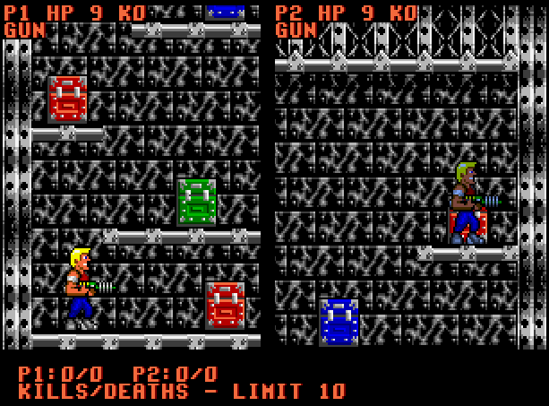

# RigelNet

**Online and split-screen deathmatch for Duke Nukem II, built on
[RigelEngine](https://github.com/lethal-guitar/RigelEngine).**

RigelNet adds multiplayer to RigelEngine, the modern re-implementation of
Duke Nukem II by Nikolai Wuttke. Single player works exactly as in
RigelEngine.

## About this project

RigelNet is a hobby project, made for fun and still under construction.
A friend of mine suggested the idea: he wanted to play Duke Nukem II
deathmatch the way NetKeen lets you play Commander Keen online, and he
recommended building it on RigelEngine. I've been developing it with the
help of AI, testing and fixing things as I go, so expect rough edges.

So far, I've only built and tested it on Windows.

 

## Features

- **Local split-screen deathmatch** for 2 to 4 players on one computer
  (keyboard and game controllers)
- **Online deathmatch**: one player hosts, others join by IP address and can
  come and go at any time
- **Client-side prediction**: your own player reacts instantly, even with a
  high ping. The host stays authoritative over damage, deaths, items and
  respawns
- **Interpolation**: other players, enemies and shots move smoothly even on
  an irregular connection, with a delay that adapts to the connection
- **Lag compensation**: the host judges your shots by what you saw on your
  screen (up to 0.8 seconds back)
- Player vs. player damage tuned for deathmatch, kill tracking, rounds with
  a frag limit
- Items and weapons re-appear after being picked up
- Enemies are removed (optional), hazards stay
- Spawn points are found automatically in any level, only in reachable areas
- A generator for a dedicated deathmatch arena map
  (`tools/deathmatch_arena/make_arena.py`)

## Requirements

You need the data files of the original game. The free shareware version
works (episode 1, maps `L1` to `L8`):
<https://archive.org/download/msdos_DUKE2_shareware/DUKE2.zip>

All players of a network game need the same game data and the same version
of RigelNet.

## Quick start

Local split-screen, 2 players:

```
RigelEngine --deathmatch -l L1 <path to game data>
```

Host a network game (up to 4 players, including you):

```
RigelEngine --host -l L1 <path to game data>
```

Join a network game:

```
RigelEngine --connect <host IP address> <path to game data>
```

The host needs to allow UDP port 7777 through the firewall, and forward it on
the router for games over the internet (or use a virtual LAN tool like
ZeroTier, Tailscale or Radmin VPN).

### Controls

| | Player 1 | Player 2 (split-screen) | Players 3/4 (split-screen) |
|---|---|---|---|
| Move | Arrow keys | W A S D | Game controller |
| Jump | Ctrl | G | Game controller |
| Fire | Alt | F | Game controller |

Player 1 uses the keys configured in the game's options menu. Game controllers
are assigned in the order they were connected.

### Command line options

| Option | Description | Default |
|---|---|---|
| `--deathmatch` | Local split-screen deathmatch | |
| `--host` | Host a network deathmatch | |
| `--connect <address>` | Join a network game (`ip` or `ip:port`) | |
| `--port <number>` | UDP port for hosting | 7777 |
| `--players <2-4>` | Number of players (including the host) | 2 local, 4 hosting |
| `--frag-limit <kills>` | Kills needed to win a round | 10 |
| `--item-respawn <seconds>` | Time until items re-appear | 20 |
| `--keep-enemies` | Don't remove enemies | |
| `-l <map>` | Map, e.g. `L1`. The host's choice is used for everyone | `L1` |
| `--no-lag-compensation` | Host: judge hits by where players are on the host | |
| `--simulate-lag <ms>` | Testing: add latency to a client's connection | 0 |
| `--simulate-jitter <ms>` | Testing: make a client's latency vary randomly | 0 |

## Building

So far, RigelNet has only been built and tested on **Windows**, with
Visual Studio 2026. It should build on Linux and macOS the same way as
RigelEngine (see [BUILDING.md](BUILDING.md)), but that hasn't been tried
yet.

### Windows

1. **Install Visual Studio 2026** with the **Desktop development with C++**
   workload. This also installs CMake.

2. **Install vcpkg and the libraries.** In a terminal:

   ```
   git clone https://github.com/microsoft/vcpkg C:\vcpkg
   C:\vcpkg\bootstrap-vcpkg.bat
   C:\vcpkg\vcpkg install sdl2:x64-windows sdl2-mixer:x64-windows
   ```

   You can put vcpkg somewhere else, just change `C:\vcpkg` in the steps
   below too.

3. **Get the source code**, including the submodules (libraries that are
   downloaded separately, the build fails without them):

   ```
   git clone --recursive https://github.com/MarioJCh12/RigelNet
   cd RigelNet
   ```

   If you already cloned without `--recursive`, run
   `git submodule update --init --recursive` inside the folder.

4. **Configure and build.** Open **Developer PowerShell for VS 2026** from
   the Start menu (a regular terminal doesn't find CMake), go to the
   `RigelNet` folder, and run:

   ```
   cmake -S . -B build -G "Visual Studio 18 2026" -A x64 "-DCMAKE_TOOLCHAIN_FILE=C:/vcpkg/scripts/buildsystems/vcpkg.cmake" "-DCMAKE_POLICY_VERSION_MINIMUM=3.5"
   cmake --build build --config Release --target RigelEngine
   ```

   In PowerShell, keep the quotes around the `-D...` options. Without them,
   PowerShell splits them up and CMake fails with confusing errors. The
   `CMAKE_POLICY_VERSION_MINIMUM` option is needed because one of the
   included libraries is older than what CMake 4 accepts by default.

   Instead of the second command, you can also open `build\RigelEngine.sln`
   in Visual Studio, choose **Release**, and build the **RigelEngine**
   project.

5. **Run it.** The game ends up in `build\src\Release\RigelEngine.exe`,
   with the DLLs it needs next to it. See [Quick start](#quick-start) for
   how to start a game.

After pulling new changes, only the build command from step 4
(`cmake --build ...`) is needed again.

The networking library ([ENet](https://github.com/lsalzman/enet)) is
included in `3rd_party/enet`, there's nothing extra to install for it.

## How the network mode works

The host runs the game. Clients send their input each frame, numbered, and
receive a snapshot per frame with what to draw: sprites (in world
coordinates), changes to the map, sounds, messages and scores. Each client
also simulates its own player locally with the same physics. The host
applies each client's inputs in the same order, one per frame, and sends back
where that player actually ended up, so clients can correct small
differences.

Everything else is shown slightly in the past: clients buffer a few
snapshots and play them back at a steady pace, interpolating sprite
positions between them. The delay adapts to how irregular the connection is.
Since clients see others in the past, the host keeps a short history of
each player's hit box and checks shots against where the target was on the
shooter's screen (lag compensation, capped at 12 frames). On the host, each
client's inputs go through an adaptive buffer that absorbs irregular
arrival without building up extra delay.

More details are in the source:
`src/game_logic/game_world_network.cpp` and `src/frontend/network_session.cpp`.

## Credits and license

- [RigelEngine](https://github.com/lethal-guitar/RigelEngine) by Nikolai
  Wuttke and contributors. The original project README is in
  [README.RigelEngine.md](README.RigelEngine.md), the list of authors in
  [AUTHORS.md](AUTHORS.md)
- [ENet](https://github.com/lsalzman/enet) by Lee Salzman (MIT license)
- Duke Nukem II was released by Apogee Software in 1993. RigelNet is not
  affiliated with the owners of Duke Nukem. You need the original game's data
  files to play

Like RigelEngine, RigelNet is licensed under the GNU General Public License
version 2 (or later), see [LICENSE.md](LICENSE.md).
