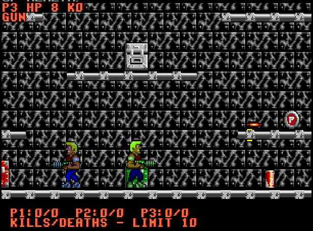

# RigelNet

**Online and split-screen deathmatch for Duke Nukem II, built on
[RigelEngine](https://github.com/lethal-guitar/RigelEngine).**

> 🇪🇸 Guía completa en español: [DEATHMATCH.md](DEATHMATCH.md)

RigelNet adds multiplayer to RigelEngine, the modern re-implementation of
Duke Nukem II by Nikolai Wuttke. Single player works exactly as in
RigelEngine.

 

## Features

- **Local split-screen deathmatch** for 2 to 4 players on one computer
  (keyboard and game controllers)
- **Online deathmatch**: one player hosts, others join by IP address and can
  come and go at any time
- **Client-side prediction**: your own player reacts instantly, even with a
  high ping. The host stays authoritative over damage, deaths, items and
  respawns
- Player vs. player damage tuned for deathmatch, kill tracking, rounds with
  a frag limit
- Items and weapons re-appear after being picked up
- Enemies are removed (optional), hazards stay
- Spawn points are found automatically in any level, only in reachable areas
- A generator for a dedicated deathmatch arena map
  (`tools/deathmatch_arena/make_arena.py`)

## Requirements

You need the data files of the original game. The free shareware version
works (episode 1, maps `L1` to `L8`):
<https://archive.org/download/msdos_DUKE2_shareware/DUKE2.zip>

All players of a network game need the same game data and the same version
of RigelNet.

## Quick start

Local split-screen, 2 players:

```
RigelEngine --deathmatch -l L1 <path to game data>
```

Host a network game (up to 4 players, including you):

```
RigelEngine --host -l L1 <path to game data>
```

Join a network game:

```
RigelEngine --connect <host IP address> <path to game data>
```

The host needs to allow UDP port 7777 through the firewall, and forward it on
the router for games over the internet (or use a virtual LAN tool like
ZeroTier, Tailscale or Radmin VPN).

### Controls

| | Player 1 | Player 2 (split-screen) | Players 3/4 (split-screen) |
|---|---|---|---|
| Move | Arrow keys | W A S D | Game controller |
| Jump | Ctrl | G | Game controller |
| Fire | Alt | F | Game controller |

Player 1 uses the keys configured in the game's options menu. Game controllers
are assigned in the order they were connected.

### Command line options

| Option | Description | Default |
|---|---|---|
| `--deathmatch` | Local split-screen deathmatch | |
| `--host` | Host a network deathmatch | |
| `--connect <address>` | Join a network game (`ip` or `ip:port`) | |
| `--port <number>` | UDP port for hosting | 7777 |
| `--players <2-4>` | Number of players (including the host) | 2 local, 4 hosting |
| `--frag-limit <kills>` | Kills needed to win a round | 10 |
| `--item-respawn <seconds>` | Time until items re-appear | 20 |
| `--keep-enemies` | Don't remove enemies | |
| `-l <map>` | Map, e.g. `L1`. The host's choice is used for everyone | `L1` |
| `--simulate-lag <ms>` | Testing: add latency to a client's connection | 0 |

## Building

Same as RigelEngine, see [BUILDING.md](BUILDING.md). The networking library
([ENet](https://github.com/lsalzman/enet)) is included in `3rd_party/enet`,
no extra dependencies are needed.

With Visual Studio 2026 / CMake 4, add `-DCMAKE_POLICY_VERSION_MINIMUM=3.5`
when running CMake. Step-by-step Windows instructions are in
[DEATHMATCH.md](DEATHMATCH.md) (Spanish).

## How the network mode works

The host runs the game. Clients send their input each frame, numbered, and
receive a snapshot per frame with what to draw: sprites (in world
coordinates), changes to the map, sounds, messages and scores. Each client
also simulates its own player locally with the same physics. The host
applies each client's inputs in the same order, one per frame, and sends back
where that player actually ended up, so clients can correct small
differences. More details are in the source:
`src/game_logic/game_world_network.cpp` and `src/frontend/network_session.cpp`.

## Credits and license

- [RigelEngine](https://github.com/lethal-guitar/RigelEngine) by Nikolai
  Wuttke and contributors. The original project README is in
  [README.RigelEngine.md](README.RigelEngine.md), the list of authors in
  [AUTHORS.md](AUTHORS.md)
- [ENet](https://github.com/lsalzman/enet) by Lee Salzman (MIT license)
- Duke Nukem II was released by Apogee Software in 1993. RigelNet is not
  affiliated with the owners of Duke Nukem. You need the original game's data
  files to play

Like RigelEngine, RigelNet is licensed under the GNU General Public License
version 2 (or later), see [LICENSE.md](LICENSE.md).
